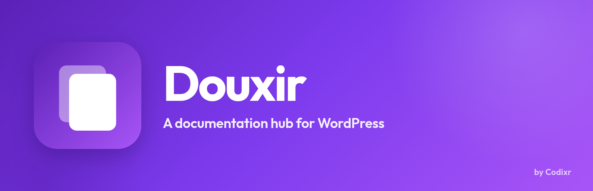
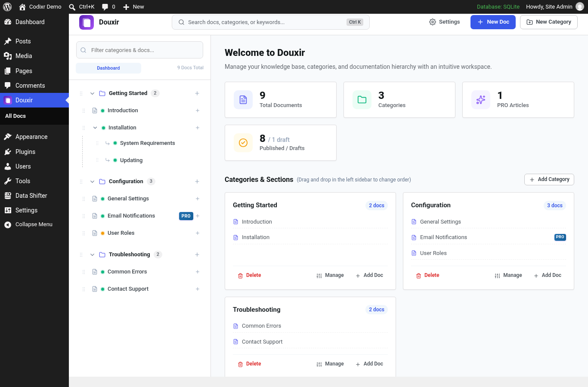
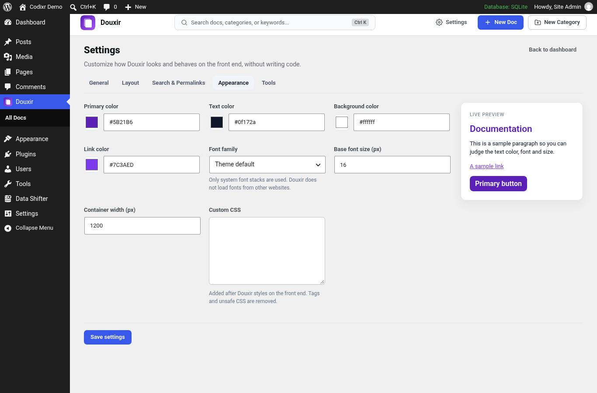
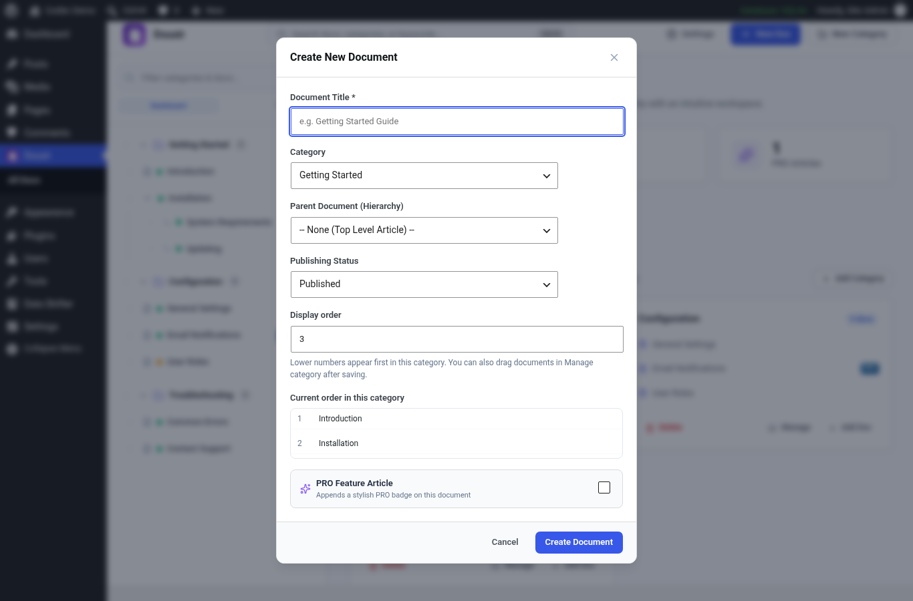
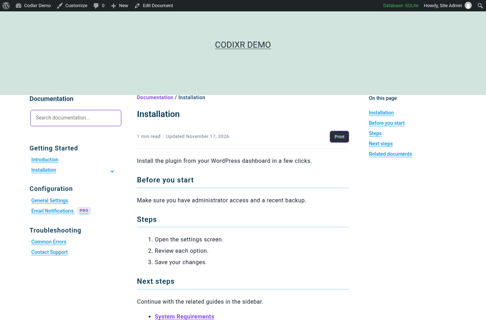
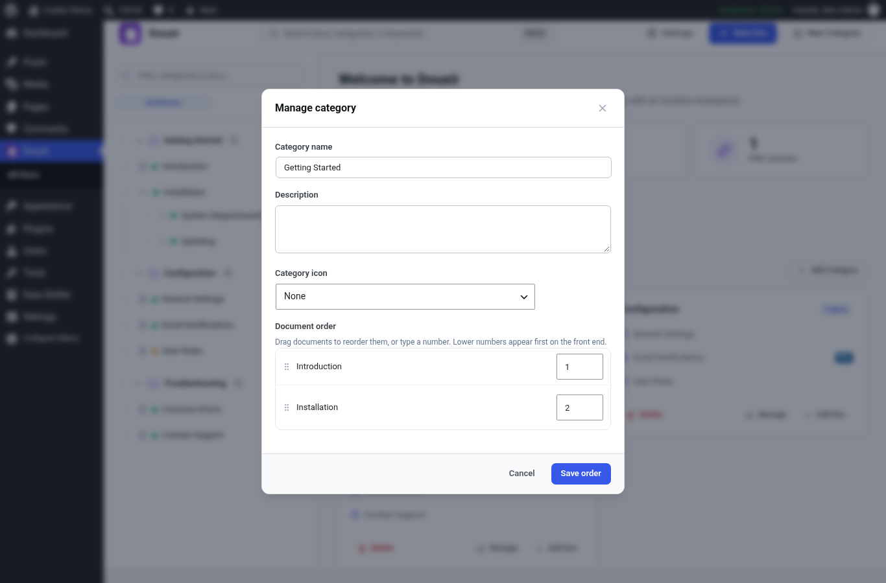

# Douxir

[](#requirements)
[](#requirements)
[](LICENSE)
[](#changelog)

<p align="center">
  
</p>

Build a searchable documentation hub in WordPress, with nested documents, categories, a table of contents and a drag-and-drop admin screen.

Write documents in the block editor, group them into categories, nest them under parent documents and arrange everything on the Douxir dashboard — a single admin screen for your whole knowledge base.

## Features

### For readers

- Clean document layout with a sidebar, the article and an “On this page” table of contents
- Live search box that suggests matching documents as you type
- Breadcrumbs, reading time, last updated date, previous/next links, related documents and a print button
- Optional “Was this document helpful?” feedback on every article
- Collapsible sidebar groups, category icons and a mobile-friendly menu
- A documentation homepage and category archives, with pretty URLs such as `/documentation/getting-started/installation/`

### For editors

- Douxir dashboard: browse categories and documents, create and quick-edit documents, change status, parent and order, and preview content
- A Settings screen (its own admin page) to control the docs slug, archive and single-document layout, search, permalinks and appearance
- Front-end colors, typography, container width, card style and custom CSS, applied with CSS variables. A live preview is shown while you edit
- Create and delete categories without leaving the dashboard. Deleting a category never deletes its documents. Categories can have icons and descriptions
- Drag and drop to reorder documents and categories, plus a numeric display-order field when you add a document or manage a category
- Optional “pro” badge for documents that cover premium features
- Import and export your knowledge base as a JSON file
- Works with the block editor and the REST API

Front-end customization needs no code: colors, fonts, layout and custom CSS can all be changed from Settings. Douxir does not load fonts or files from other websites, and it does not send data to Codixr or to any other service.

## Screenshots

**Douxir dashboard:** categories, nested documents and stats in one screen.



**Settings:** layout, colors and a live appearance preview.



**Create a new document,** including a display-order field.



**Front end:** document layout with sidebar, search, reading time and table of contents.



**Manage a category:** drag-and-drop and numeric document order.



## Requirements

- WordPress 6.0 or later (tested up to 7.1)
- PHP 7.4 or later
- Users who can edit posts can open the Douxir dashboard. Publishing, editing and deleting a document follow normal WordPress permissions, and managing categories requires the “manage categories” capability. The Settings screen requires the `manage_options` capability.

To rebuild the admin dashboard or blocks from source you also need Node.js 18 or later. Compiled assets are already included in the release ZIP, so this is only needed if you change the code in `src/`.

## Installation

### From a release ZIP (recommended)

1. Download `douxir-1.0.0.zip` from the [Releases](../../releases) page of this repository.
2. In your WordPress admin, go to **Plugins → Add New → Upload Plugin**, choose the ZIP file and click **Install Now**.
3. Activate the plugin.
4. Open **Douxir** in the admin menu to create your first category and document.
5. Visit any document on the front end to see the documentation layout. If links return a 404 error, go to **Settings → Permalinks** and click **Save Changes** to refresh your permalinks.

### Manual install

1. Download `douxir-1.0.0.zip` from the Releases page and unzip it.
2. Upload the `douxir` folder to `wp-content/plugins/` on your site (for example with SFTP).
3. In the WordPress admin, go to **Plugins** and activate **Douxir**.
4. Open **Douxir** in the admin menu and create your first category and document.

## Usage

Documents live under `/documentation/` by default (the slug is configurable in Settings). Douxir uses its own templates for single documents, category archives and the documentation homepage so the sidebar and table of contents always work. You can also place the shortcodes or blocks on any page, and choose a custom documentation homepage in Settings.

### Shortcodes

| Shortcode | Aliases | What it shows |
| --- | --- | --- |
| `[documentation_list]` | `[douxir_list]` | Sidebar navigation with search, or a document list/grid |
| `[documentation_content]` | `[douxir_content]` | The current document, including the layout options from Settings |
| `[doc_categories_list]` | `[douxir_categories]` | A list or grid of categories |
| `[douxir_search]` | — | A live search box |

**`[documentation_list]` / `[douxir_list]` attributes**

| Attribute | Default | Description |
| --- | --- | --- |
| `category` | _(empty)_ | Limit documents to a category slug or term ID |
| `layout` | `nav` | `nav` (sidebar navigation), `list` or `grid` |
| `columns` | `0` | Column count for the grid layout |
| `limit` | `-1` | Maximum number of documents (`-1` means no limit for `nav`; the catalog layouts default to 12 when unset) |
| `show_search` | _(empty)_ | Set to `yes`, `1` or `true` to include a live search box above a list or grid |
| `parent` | `0` | Only include documents whose parent is this document ID |

Example:

```
[documentation_list category="getting-started" layout="grid" columns="3" limit="12" show_search="yes"]
```

**`[doc_categories_list]` / `[douxir_categories]` attributes**

| Attribute | Default | Description |
| --- | --- | --- |
| `layout` | _(from Settings)_ | `grid` or `list`. If omitted, the archive layout from Settings is used |
| `columns` | _(from Settings)_ | Column count, 1–4. If omitted, the archive columns setting is used |

**`[douxir_search]` attributes**

| Attribute | Default | Description |
| --- | --- | --- |
| `placeholder` | _(from Settings)_ | Search field placeholder. If omitted, the placeholder from Settings is used, or “Search documentation…” |

### Gutenberg blocks

The same output is available as blocks in the editor:

- **Douxir Documents** (`douxir/docs-list`)
- **Douxir Search** (`douxir/search`)
- **Douxir Categories** (`douxir/categories`)

### Settings

The Settings screen is a separate item under the Douxir admin menu, with tabs for General, Layout, Search & Permalinks, Appearance and Tools. From there you can change the docs slug, archive and single-document layout, live search, permalinks, colors, typography, container width, card style and custom CSS, and import or export the knowledge base as JSON. A live preview is shown while you edit appearance settings.

### Upgrading from Custom Documentation

Douxir is the renamed successor of the “Custom Documentation” plugin. Documents, categories, shortcodes and URLs keep working: the post type (`custom_docs`), taxonomy (`doc_category`), “pro” meta key and shortcode names are unchanged. The saved category order is copied to a new Douxir option the first time an administrator opens the dashboard, and the old option is left in place. Deactivate the old plugin before activating Douxir.

If Advanced Custom Fields is active, Douxir also reads and writes the `documentation_pro` field through ACF. ACF is not required.

## Building from source

The Douxir dashboard and blocks are built with [@wordpress/scripts](https://developer.wordpress.org/block-editor/reference-guides/packages/packages-scripts/). The plugin uses the React copy that ships with WordPress (`wp-element`) instead of bundling its own. The readable source is in the `src/` folder. Compiled files in `assets/dist/` are already included in the release, so you only need to rebuild if you change the source.

1. Install [Node.js](https://nodejs.org/) 18 or later.
2. From this plugin directory, install dependencies and build:

   ```bash
   npm install
   npm run build
   ```

3. This writes `assets/dist/admin-app.js`, `assets/dist/blocks.js` and their matching `.asset.php` files.

For a watch build while you edit, run `npm start`.

## Frequently Asked Questions

**Where do documents appear on my site?**

Each document has its own URL under `/documentation/`. If links return a 404 error, go to **Settings → Permalinks** and click **Save Changes** to refresh your permalinks.

**Can I use my theme’s template instead?**

Douxir uses its own template for single documents, category archives and the documentation homepage so the sidebar and table of contents always work. You can also place the shortcodes or blocks on any page, and choose a custom documentation homepage in Settings.

**Can readers customize the look without code?**

Editors with the “manage options” capability can change colors, fonts, layout and add custom CSS from the Douxir Settings screen. The styles are output as CSS variables. Douxir does not load fonts or files from other websites.

**Who can manage documents?**

Users who can edit posts can open the Douxir dashboard. Publishing, editing and deleting a document follow normal WordPress permissions, and managing categories requires the “manage categories” capability.

**What happens to documents when I delete a category?**

They are kept. Deleting a category only removes the category itself. Documents that were in it stay published (or in whatever status they had) and move to “Uncategorized” unless they also belong to another category. Child documents stay under their parent document, and subcategories move up one level. You can assign the documents to another category later with Quick Edit.

**Does it work with Advanced Custom Fields?**

Yes. If ACF is active, Douxir also reads and writes the `documentation_pro` field through ACF. ACF is not required.

**Where can I get help?**

Email [support@codixr.com](mailto:support@codixr.com) or visit [codixr.com](https://codixr.com).

## Contributing

Issues and pull requests are welcome.

- Please keep changes focused and describe what you changed and why.
- Follow the [WordPress Coding Standards](https://developer.wordpress.org/coding-standards/).
- Edit the readable source in `src/` and run `npm run build` before you commit, so `assets/dist/` stays in sync.
- The admin app depends on WordPress-provided scripts (`wp-element`, `react-jsx-runtime`, `wp-api-fetch` and `wp-i18n`). Do not bundle a separate copy of React.
- If you update translatable strings, refresh `languages/douxir.pot`.

For support rather than a code change, email [support@codixr.com](mailto:support@codixr.com).

## Changelog

See [CHANGELOG.md](CHANGELOG.md) for the full history.

### 1.0.0

- Initial release.

## License

Douxir is free software, licensed under the [GNU General Public License v2.0 or later](LICENSE).

---

Made by [Codixr](https://codixr.com), a software agency.
